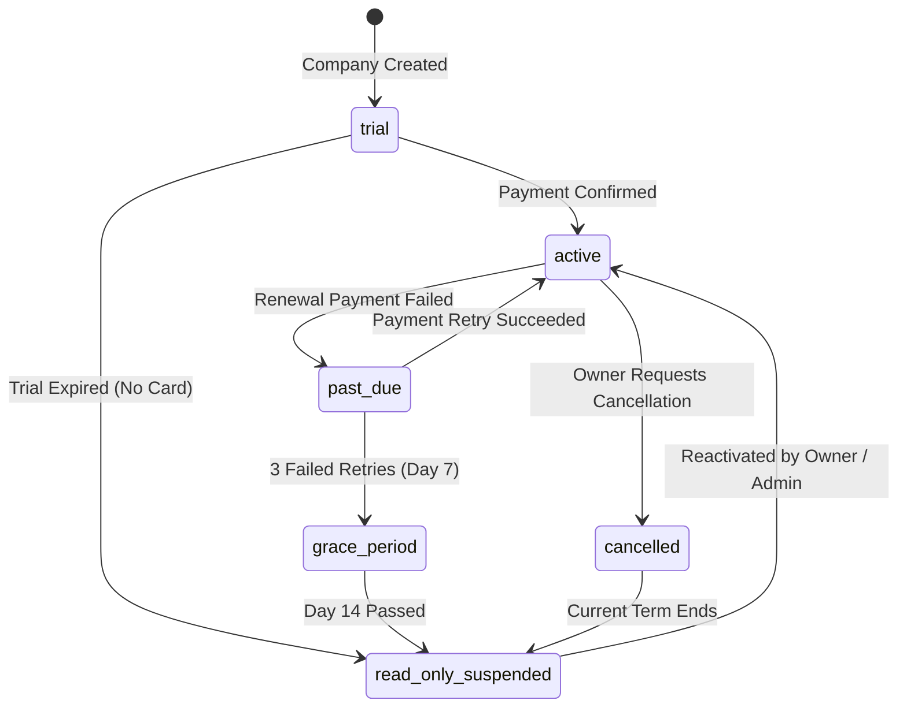

# Global SaaS Billing & Subscription Architecture
**Global ERP**  
*Document Status: Architecture & Security Specification | Design Only (Zero Payment Gateway Code)*

---

## 1. BUSINESS MODEL OVERVIEW

The platform operates as a global multi-tenant Software-as-a-Service (SaaS) application priced primarily on a **per-user / per-seat recurring subscription** model.

**Design Constraints**:
- **Design-Only Stage**: No payment provider SDKs, checkout webhooks, or merchant credentials are integrated at this stage.
- **Provider-Agnostic Boundary**: Core subscription state and entitlement logic are strictly isolated behind an abstract payment adapter interface (`IPaymentProviderAdapter`).
- **Web-Only Billing**: All subscription purchases, tier upgrades, seat additions, and card management are hosted exclusively on the web application. Mobile APK and Windows desktop clients do not sell subscriptions or embed checkout flows.

---

## 2. PLANS & ENTITLEMENTS MODEL

### 2.1 Plan Tiers & Capabilities Architecture

Plans define the baseline envelope of operational capacities and accessible vertical modules. Final pricing and statutory tax rates are determined during commercial launch; this architecture establishes the technical entitlement structure:

```
┌────────────────────────────────────────────────────────────────────────┐
│                        SaaS PLAN TIERS & QUOTAS                        │
├─────────────────────┬──────────────────┬───────────────────────────────┤
│ PLAN TIER           │ INCLUDED SEATS   │ ENTITLED MODULES & QUOTAS     │
├─────────────────────┼──────────────────┼───────────────────────────────┤
│ Starter             │ Up to 3 seats    │ Core Accounting, Invoicing,   │
│                     │ 1 Company        │ Bills, UAE VAT, Single Branch │
├─────────────────────┼──────────────────┼───────────────────────────────┤
│ Professional        │ Up to 10 seats   │ Multi-Branch, Inventory, POS, │
│                     │ Up to 3 Companies│ Landed Cost, Period Locking   │
├─────────────────────┼──────────────────┼───────────────────────────────┤
│ Enterprise          │ 25+ seats        │ Manufacturing BOM, Projects,  │
│                     │ Unlimited Comp.  │ WPS Payroll, Custom Dimensions│
└─────────────────────┴──────────────────┴───────────────────────────────┘
```

### 2.2 Central Entitlement Service Invariant
- **Single Source of Truth**: All entitlement evaluations occur through `EntitlementService` in the backend API.
- **No Scattered UI Plan Checks**: Frontend components must never inspect strings like `company.plan === 'enterprise'` to conditionally enable features. Instead, the UI queries normalized capability flags (e.g., `canAccessMultiWarehouse`, `canAddFullSeat`).
- **Server-Side Enforcement**: Every protected API route evaluates tenant entitlements independently of client state. Requests to disabled modules return `403 Forbidden` (`ModuleNotEntitledException`).

---

## 3. SEAT MODEL & RESERVATION RULES

### 3.1 Seat Classifications
1. **Full Seat (`seatType: 'full'`)**:
   - Authorized roles: `owner`, `admin`, `accountant`.
   - Grants full transactional write permissions (posting vouchers, issuing invoices, recording payments, editing accounts).
   - Consumes one unit of the company's `seatLimit`.
2. **Read-Only Seat (`seatType: 'read_only'`)**:
   - Authorized roles: `auditor`, `viewer`.
   - Grants read-only access to ledgers, reports, trial balances, and audit logs.
   - Billed at a nominal rate or included as complimentary secondary seats, without consuming the primary operational `seatLimit`.

### 3.2 Seat Counting & Race Condition Prevention
To prevent seat overdrafts during concurrent user invitations:
$$\text{AllocatedFullSeats} = \text{ActiveFullMemberships} + \text{PendingFullInvitations}$$

```typescript
// Atomically verified during invitation issuance:
async function verifySeatAvailability(companyId: ObjectId): Promise<void> {
  const company = await Company.findById(companyId).lean();
  const activeFull = await CompanyMembership.countDocuments({
    companyId,
    status: 'active',
    seatType: 'full',
  });
  const pendingFull = await CompanyInvitation.countDocuments({
    companyId,
    status: 'pending',
    expiresAt: { $gt: new Date() },
    role: { $in: ['owner', 'admin', 'accountant'] },
  });

  if (activeFull + pendingFull >= company.seatLimit) {
    throw new SeatLimitExceededException(
      `Seat quota reached (${company.seatLimit} seats). Please upgrade your subscription.`
    );
  }
}
```

- When the limit is reached, invitations are blocked with a clear modal directing the owner to `/settings/billing`. Extra seats are never granted silently.

---

## 4. SUBSCRIPTION LIFECYCLE & NON-DESTRUCTIVE SUSPENSION

### 4.1 State Machine & Transitions



### 4.2 Non-Destructive Data Retention Invariant
> [!IMPORTANT]
> **CRITICAL LEGAL & ARCHITECTURAL RULE**: Customer financial data is **NEVER DELETED** due to subscription expiration, payment default, suspension, or cancellation.

- **Permitted Operations During `read_only_suspended`**:
  - Viewing existing dashboards, charts, and historical ledgers.
  - Generating and exporting Trial Balance, Balance Sheet, and P&L reports.
  - Downloading PDF invoices, General Ledger CSVs, and FTA Audit Files (FAF).
  - Creating and downloading full database backups.
- **Blocked Operations During `read_only_suspended`**:
  - Creating or posting new vouchers (Journal, Payment, Receipt, Contra).
  - Issuing new sales invoices or recording vendor bills.
  - Adding or modifying Chart of Accounts records.
  - Inviting new users or adding branches.

---

## 5. MINIMAL TENANT & MEMBERSHIP SCHEMA HOOKS

The following minimal, non-breaking schema additions are established in `packages/contracts` and `packages/database`:

### 5.1 `Company` Schema Additions
```typescript
plan: {
  type: String,
  default: 'starter',
  index: true,
},
subscriptionStatus: {
  type: String,
  enum: ['trial', 'active', 'past_due', 'grace_period', 'read_only_suspended', 'cancelled'],
  default: 'trial',
  index: true,
},
seatLimit: {
  type: Number,
  default: 3,
  min: 1,
},
trialEndsAt: {
  type: Date,
  default: () => new Date(Date.now() + 14 * 24 * 60 * 60 * 1000), // 14-day trial
},
entitlements: {
  type: [String],
  default: ['core_accounting', 'invoicing', 'standard_reports'],
}
```

### 5.2 `CompanyMembership` Schema Additions
```typescript
seatType: {
  type: String,
  enum: ['full', 'read_only'],
  default: 'full',
  index: true,
}
```

### 5.3 Rationale & Migration Safety
- **Additive Only**: All fields provide sensible defaults (`plan: 'starter'`, `seatLimit: 3`, `seatType: 'full'`), ensuring existing documents in MongoDB require zero breaking backfills.
- **Indexed**: `subscriptionStatus` and `plan` are indexed to enable fast tenant filtering by Platform Super Admin.

---

## 6. PROVIDER-AGNOSTIC PAYMENT BOUNDARY

To prevent vendor lock-in to Stripe, Paddle, or Lemon Squeezy, core billing logic interfaces solely with `IPaymentProviderAdapter`:

```typescript
export interface CheckoutSessionInput {
  companyId: string;
  tenantEmail: string;
  planId: string;
  seats: number;
  successUrl: string;
  cancelUrl: string;
}

export interface PortalSessionInput {
  companyId: string;
  returnUrl: string;
}

export interface WebhookProcessingResult {
  eventType: 'subscription.created' | 'subscription.renewed' | 'payment.failed' | 'subscription.cancelled';
  companyId: string;
  newStatus: 'active' | 'past_due' | 'read_only_suspended';
  currentPeriodEnd: Date;
  seatCount: number;
}

export interface IPaymentProviderAdapter {
  readonly providerName: string;
  createCheckoutSession(input: CheckoutSessionInput): Promise<{ checkoutUrl: string }>;
  createCustomerPortalSession(input: PortalSessionInput): Promise<{ portalUrl: string }>;
  handleWebhookEvent(rawPayload: Buffer, signature: string): Promise<WebhookProcessingResult>;
}
```

---

## 7. SUPER ADMIN BILLING CAPABILITIES

In the Platform Super Admin interface (`/admin`), operators manage tenant subscriptions with full audit logging:

1. **Live Subscription Overview**: Filterable table showing all tenant companies, active plans, subscription status pills (`ACTIVE`, `TRIAL`, `SUSPENDED`), and seat utilization ratios.
2. **Manual Overrides & Trial Extensions**:
   - Super Admins can manually extend trial periods or override suspension for client onboarding.
   - **Mandatory Audit Policy**: Every manual override requires an explicit reason (e.g., "Extended trial by 14 days for Enterprise pilot evaluation - Ticket #4012") and is permanently recorded in the security audit log.
3. **Usage Metrics**: Storage consumption, transaction volume, and active user metrics across tenants.

---

## 8. LEGAL & LAUNCH READINESS CHECKLIST

Before launching global SaaS subscription billing, the following legal and regulatory instruments must be formally drafted, reviewed, and certified by qualified legal counsel and tax advisors:

> [!CAUTION]
> **LEGAL / ACCOUNTING REVIEW REQUIRED**: The following checklist items represent mandatory commercial compliance areas. Do not deploy billing without professional legal certification.

- [ ] **Terms of Service (ToS)**:
  - Definition of subscription terms, automatic renewal terms, and cancellation notice periods.
  - Service Level Agreement (SLA) commitments and uptime disclaimers.
  - Limitation of liability for financial or accounting discrepancies.
- [ ] **Privacy Policy & Global Data Protection**:
  - Compliance with GDPR (Europe), UAE Federal Decree-Law No. 45 of 2021 on Personal Data Protection, and regional data protection laws.
  - Transparent disclosure of third-party processors (cloud hosting, database clusters, email services).
- [ ] **Data Processing Agreement (DPA)**:
  - Standard contractual clauses governing customer business and employee data processed within the platform.
- [ ] **Refund & Cancellation Policy**:
  - Explicit refund terms (e.g., non-refundable pro-rated periods vs cooling-off periods).
- [ ] **Data Export & Retention Policy**:
  - Commitment to preserve customer accounting data in read-only format for statutory retention periods (e.g., 5 years under UAE VAT law).
- [ ] **SaaS Sales Tax / VAT Compliance for Subscription Revenue**:
  - **Merchant of Record (MoR) vs Direct Processing**: Determining whether to use an MoR (e.g., Paddle/Lemon Squeezy) to handle global digital sales tax or direct merchant accounts (Stripe) requiring tax registration in every jurisdiction where customers reside.
  - Strict separation between SaaS subscription tax accounting and customer companies' internal VAT configurations.
